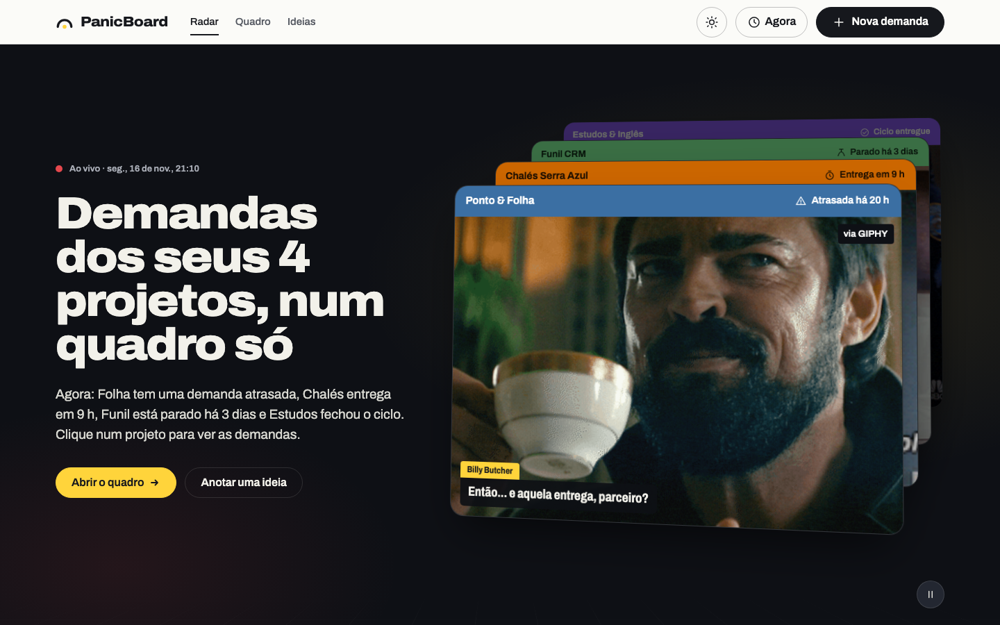
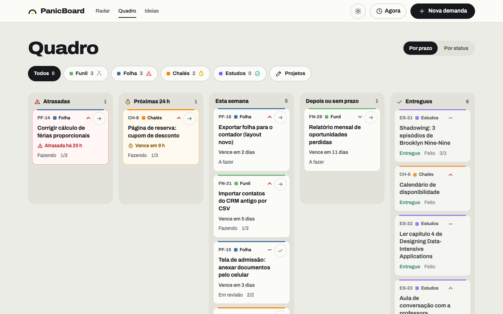
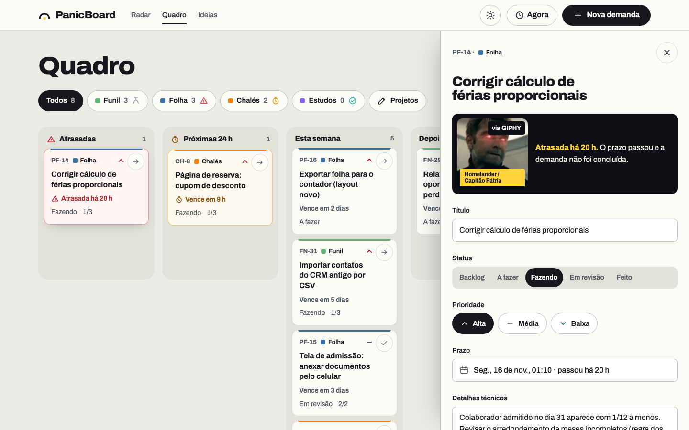
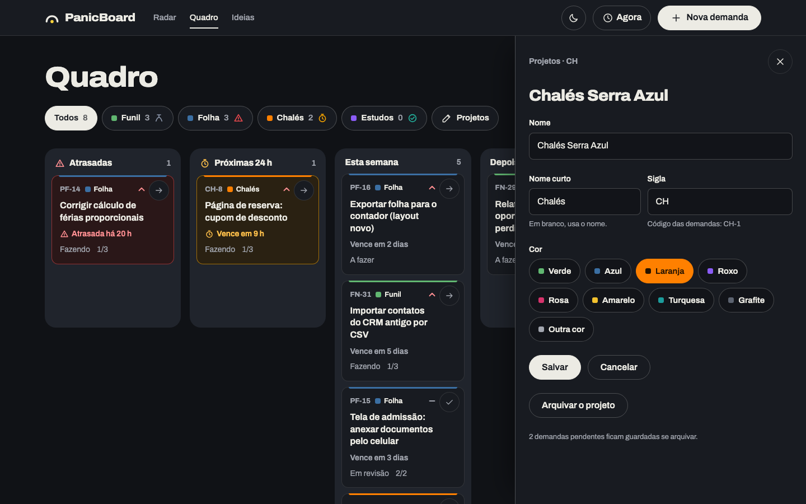
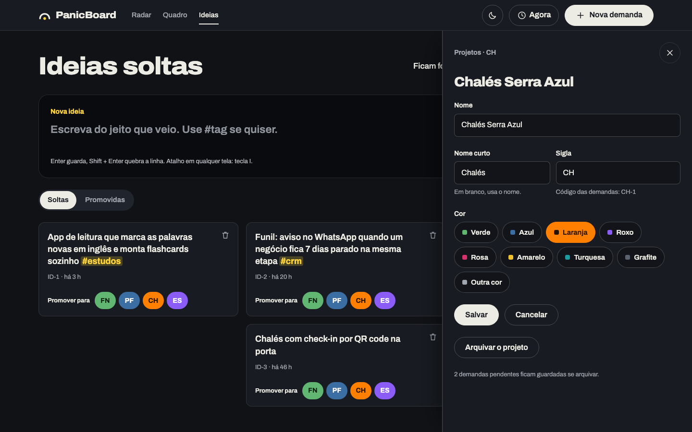

# PanicBoard

Um quadro de demandas para quem toca vários projetos ao mesmo tempo. Você vê num olhar onde está o fogo, e quando um prazo aperta o painel reage com um GIF de série.

**[Experimente a demonstração](https://emanoel-rodrigues-dev.github.io/panicboard/)**: abre no navegador, com projetos de exemplo e sem cadastro. O que você mexer fica só no seu navegador.



## Veja funcionando

**Radar e relógio simulado:** avance o relógio e veja um projeto perder o prazo e ganhar a reação de atraso crítico.

https://github.com/user-attachments/assets/47793f5d-1026-49eb-a4e6-02e6d6d9a5c7

**Entrada com o Supabase:** o quadro de exemplo mostra o app em ação, e o login é só com o e-mail, sem senha.

https://github.com/user-attachments/assets/0b4f6a2d-b3df-4aaf-94ac-ebb51b80c549

## O que ele faz

- **Radar:** os seus projetos do mais urgente para o mais calmo, cada um com o estado do momento (atrasado, prazo apertado, parado, em dia).
- **Quadro:** as demandas por prazo ou por status, filtradas por projeto. Dentro de cada raia, a prioridade alta vem primeiro.
- **Ficha:** status, prioridade, prazo, detalhes técnicos, checklist e histórico de cada mudança. Tudo salvo na hora.
- **Projetos:** cadastre os seus, com nome, sigla e cor. A cor pode vir da lista, de um código hex ou da logo do projeto. As demandas ganham código no estilo do Jira (`PF-14`).
- **Ideias:** um lugar para anotar o que aparece no meio do dia. Uma ideia vira demanda com um clique.
- **Motor de reações:** 4 regras de tempo (atrasado, vence em 24 h, parado há 48 h, ciclo entregue), cada uma com o seu GIF. Um relógio simulado deixa ver as regras mudando sem esperar.
- **Avisos:** notificação quando uma demanda atrasa, vence em 24 h ou fica parada há 48 h em Fazendo ou Em revisão (o cartão também mostra "Parado há…"), com o app aberto ou instalado.
- **Instala no celular (PWA)** e abre sem rede. Tem tema claro e escuro, e funciona com teclado e leitor de tela.

| Quadro | Ficha |
|---|---|
|  |  |
| **Projetos (tema escuro)** | **Ideias (tema escuro)** |
|  |  |

<p align="center"></p>

## Como funciona

O PanicBoard não é um serviço com cadastro. **Cada pessoa roda a própria cópia.** Há dois jeitos:

1. **Só no navegador** (padrão): sem configurar nada, os dados ficam no `localStorage` do navegador. O app abre com projetos de exemplo.
2. **Com o seu Supabase:** os dados vão para um banco seu, aparecem em todos os seus aparelhos e sincronizam em tempo real. O login é por link mágico no e-mail, sem senha.

## Rodar na sua máquina

Precisa do Node 20.19 ou mais novo (ou 22.12+).

```bash
git clone https://github.com/emanoel-rodrigues-dev/panicboard.git
cd panicboard
npm install
npm run dev        # abre em http://localhost:5313
```

Outros comandos:

```bash
npm test           # testes (Vitest)
npm run typecheck  # TypeScript
npm run lint       # regras dos hooks do React (ESLint)
npm run build      # gera o site estático em dist/
npm run preview    # serve o dist/ para conferir o build
```

## Usar com o Supabase

1. Crie um projeto grátis em [supabase.com](https://supabase.com).
2. Crie as tabelas: no painel, abra **SQL Editor** e rode o arquivo [`supabase/migrations/20261116000000_inicial.sql`](supabase/migrations/20261116000000_inicial.sql). Com a CLI, rode `supabase link` e depois `supabase db push`. As tabelas têm RLS: cada linha só pode ser lida e alterada pelo usuário dono dela.
3. Em **Authentication → URL Configuration**, coloque o endereço onde o app vai rodar em **Site URL** e também em **Redirect URLs** (por exemplo, `http://localhost:5313` e o endereço do seu site).
4. Copie o `.env.example` para `.env.local` e preencha com a URL e a chave pública (`anon` ou `publishable`), que ficam em **Project Settings → API**:

   ```bash
   cp .env.example .env.local
   ```

5. Rode `npm run dev` de novo. O app pede o seu e-mail e manda o link de entrada. No primeiro login, os dados que estavam no navegador vão para a sua conta.

**E-mail de entrada:** o modelo em [`supabase/templates/link-de-entrada.html`](supabase/templates/link-de-entrada.html) já vale no Supabase local. Na nuvem, o plano grátis só aceita modelo próprio com um servidor de e-mail seu: configure em **Authentication → Emails → SMTP Settings** e aplique o modelo com `supabase config push`. Sem isso, o Supabase manda o e-mail padrão dele, em inglês, e só para os membros da sua organização.

**Deixar só você entrar:** depois do seu primeiro login, desligue o cadastro de novos usuários em **Authentication → Providers → Email** ("Allow new users to sign up"). A chave pública vai junto no código do site, e isso é normal no Supabase: quem protege os dados é o RLS. Ainda assim, desligar o cadastro impede que outras pessoas criem contas no seu banco.

### Supabase local, no Docker

Com o Docker Desktop aberto, um comando sobe o banco, o login e o tempo real em contêineres e já preenche o `.env.local`. Não precisa instalar o CLI do Supabase.

```bash
npm run banco          # na primeira vez baixa as imagens (alguns minutos)
npm run dev
```

Entre com qualquer e-mail: o link de login cai no Mailpit local, em http://127.0.0.1:55324. O painel do banco fica em http://127.0.0.1:55323. Para desligar, rode `npm run banco:parar` (os dados ficam guardados para a próxima vez).

## Publicar

O build é um site estático (`dist/`) com caminhos relativos. Funciona em qualquer hospedagem estática: Vercel, Netlify, Cloudflare Pages, GitHub Pages ou um servidor seu. Se usar o Supabase, configure as duas variáveis `VITE_SUPABASE_*` na hospedagem antes do build e coloque o endereço do site nas URLs de redirecionamento do passo 3.

## Por dentro

- **React 19 + Vite + TypeScript** (strict), sem biblioteca de componentes. O CSS fica todo em `src/styles.css`.
- `src/domain/`: as regras, em funções puras e testadas: motor de reações, raias, ações, projetos, alertas e dados de exemplo.
- `src/data/`: onde o estado mora. A interface `Repositorio` tem duas implementações, a do navegador (`armazenamento.ts`) e a do Supabase (`supabase.ts`, que grava só o que mudou).
- `src/screens/` e `src/components/`: as telas e as peças delas.
- `public/sw.js`: o service worker. Ele guarda só os arquivos do próprio site, nunca dados.
- `PRODUCT.md` e `DESIGN.md`: o que o produto é e as regras visuais.

## Contribuir

Issues e pull requests são bem-vindos.

- Rode `npm test`, `npm run typecheck` e `npm run lint` antes de abrir o PR.
- Regra de negócio nova vem com teste, no estilo dos que já existem em `src/domain/*.test.ts`.
- Mudança visual: siga o `DESIGN.md` e coloque no PR um print de antes e depois.
- Textos da interface em português do Brasil, curtos e diretos.
- Nomes que se explicam, em português, como o resto do código.
- Comentário só quando o código sozinho não conta: o porquê de uma decisão, uma regra de negócio, um contorno de navegador. Não descreva o que a linha já diz.

## Licença e créditos

[MIT](LICENSE). Os GIFs vêm do [GIPHY](https://giphy.com), com crédito em cada um. Os personagens pertencem às suas obras.
